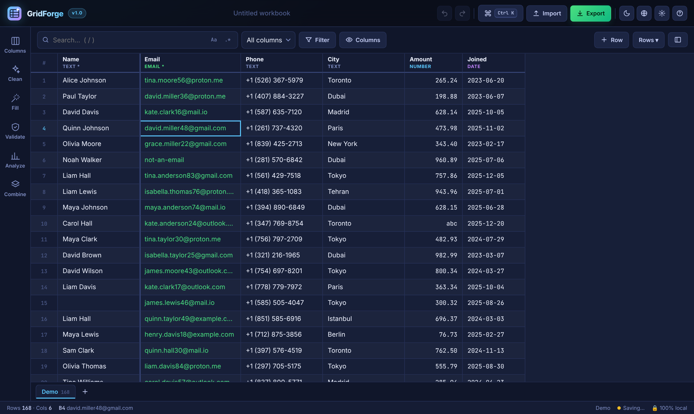
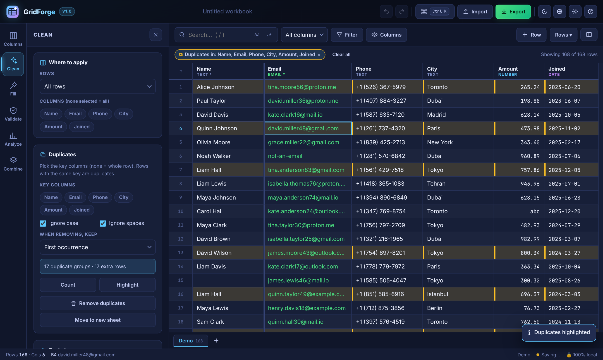
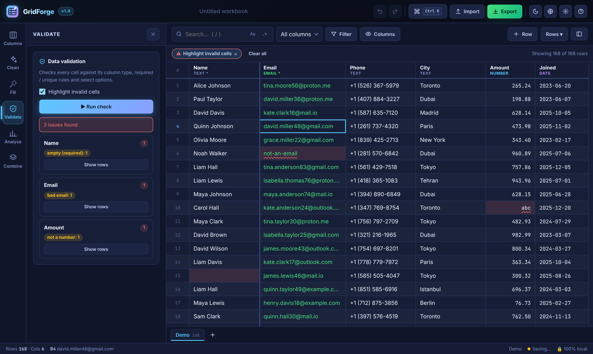
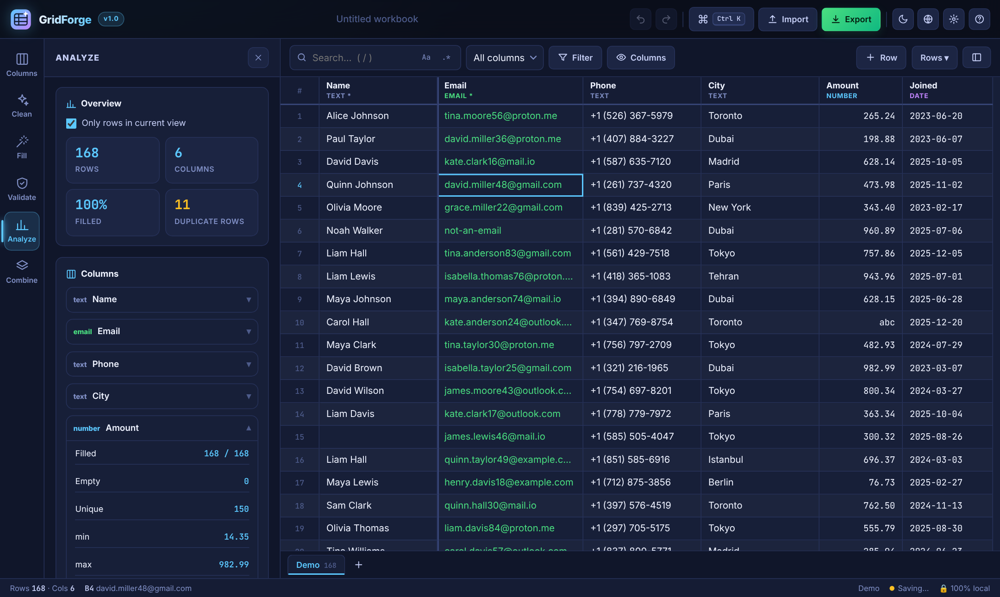
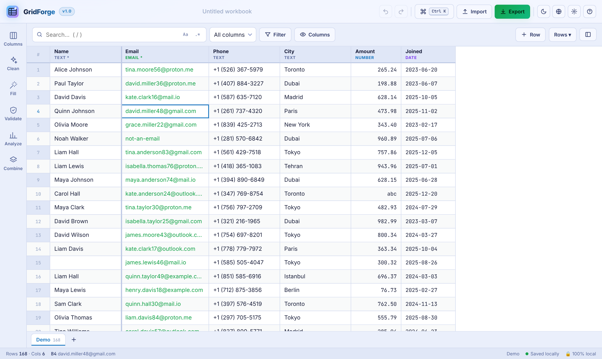
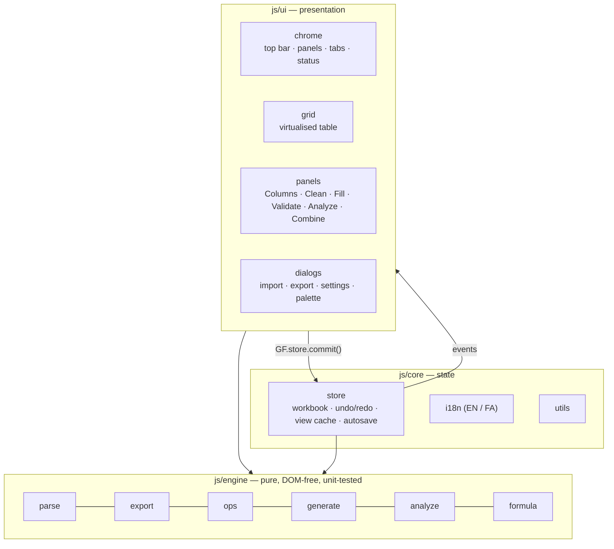

<div align="center">


<br/>

[](LICENSE)
[](#-privacy-by-construction)
[](#-architecture)
[](#-tests)
[](#-persian--rtl)

**Build, clean, de-duplicate, validate, analyze and export tabular data — entirely in your browser.**
<br/>No server. No upload. No account. No build step. Just open `index.html`.

[🌐 **Live demo**](https://ms-x01.github.io/gridforge/) · [**Quick start**](#-quick-start) · [**Features**](#-feature-tour) · [**Screenshots**](#-screenshots) · [**Formulas**](docs/FORMULAS.md) · [**Architecture**](docs/ARCHITECTURE.md) · [**FAQ**](#-faq)




</div>

<br/>

## 📑 Table of contents
- [Why GridForge](#-why-gridforge)
- [Quick start](#-quick-start)
- [Feature tour](#-feature-tour)
- [Screenshots](#-screenshots)
- [Recipes](#-recipes)
- [Import & export matrix](#-import--export-matrix)
- [Formula columns](#-formula-columns)
- [Keyboard shortcuts](#%EF%B8%8F-keyboard-shortcuts)
- [Persian & RTL](#-persian--rtl)
- [Privacy by construction](#-privacy-by-construction)
- [Architecture](#-architecture)
- [Tests](#-tests)
- [Performance](#-performance)
- [Roadmap](#-roadmap)
- [FAQ](#-faq)
- [Contributing](#-contributing) · [Author](#-author) · [License](#-license)


## 🎯 Why GridForge

Most “data cleanup” tools are either **heavy desktop suites** or **web apps that want your file uploaded**. GridForge is a third thing: a fast, structured, hackable spreadsheet studio that lives in a folder and runs on your machine.

| | **GridForge** | Excel / Sheets | Online CSV tools | OpenRefine |
|---|:---:|:---:|:---:|:---:|
| Works offline, zero install | ✅ | ⚠️ install / account | ❌ | ❌ (needs Java) |
| Your data never leaves the browser | ✅ *(CSP-enforced)* | ❌ cloud / ⚠️ | ❌ | ✅ |
| 200 k+ rows, smooth scrolling | ✅ | ✅ | ⚠️ | ✅ |
| One-click duplicate finder + “move to sheet” | ✅ | ⚠️ manual | ⚠️ | ✅ |
| Persian/Arabic digit & letter cleanup, Windows-1256 | ✅ | ❌ | ❌ | ⚠️ |
| Full RTL interface | ✅ | ⚠️ | ❌ | ❌ |
| Open source & hackable (vanilla JS, no framework) | ✅ MIT | ❌ | ❌ | ✅ |

## 🚀 Quick start

```bash
git clone https://github.com/MS-X01/gridforge.git
cd gridforge

# option 1 — just open it (works from file://)
open index.html            # macOS   |  xdg-open index.html  (Linux)  |  start index.html  (Windows)

# option 2 — tiny static server
python3 -m http.server 8080    # then visit http://localhost:8080
```

**Host it free on GitHub Pages:** *Settings → Pages → Source: GitHub Actions* — the included workflow deploys the repo root.

> First time? Click **✨ Try demo data** on the welcome screen — it is deliberately messy (duplicates, bad emails, mixed case) so you can try every tool in a minute.

## 🧰 Feature tour

<table>
<tr><td width="50%" valign="top">

### 🧮 The grid
- Virtualised rendering — **200 k rows stay at 60 fps**
- In-cell editing, range selection, **copy / cut / paste** (Excel-compatible)
- Fill down / right, resizable columns, frozen first column
- Multi-column sort (`Shift`+click), 16 filter operators, **regex search**
- Multi-sheet workbooks with drag-to-reorder tabs
- Unlimited-ish **undo / redo**, autosave to IndexedDB

</td><td width="50%" valign="top">

### 🧬 Duplicates
- Pick the **key columns** (or whole row)
- Ignore case & spaces, digit-style aware (`۱۲۳` = `123`)
- Keep **first / last / none**
- **Highlight** in the grid, **count**, **remove**
- **Move duplicates to a new sheet** instead of deleting
- One-click “show only duplicates” from any column menu

</td></tr>
<tr><td valign="top">

### ✨ Clean
- Trim & collapse spaces · UPPER / lower / Title case
- Strip HTML, punctuation, hidden characters
- **Persian ↔ English digits**, **Arabic ي ك → ی ک**, strip diacritics
- Fill empty cells: from above / below / mean / median / most common
- Split & merge columns · find & replace (**regex with groups**, whole-cell)
- Keep / delete filtered rows · make a sort permanent · shuffle

</td><td valign="top">

### 🪄 Fill & generate
- Sequences, dates, UUIDs, emails, prices, random ints, lists
- Patterns like `ID-{nn}`, `{n}`, `{rand}`
- English **and Persian** names & cities, Iranian mobile numbers
- **Smart sample rows** — realistic data guessed from each column’s name & type
- Reproducible with seeded randomness

</td></tr>
<tr><td valign="top">

### 🛡 Validate
- Type checks: number, date, boolean, email, URL, select options
- **Required** and **unique** rules per column
- Highlight bad cells, one click to jump to the offending rows
- Normalise a column to its canonical type format

</td><td valign="top">

### 📊 Analyze
- Per-column stats: mean, median, σ, quartiles, **histogram**, top values
- **Group-by & aggregate** (count, sum, avg, min, max, median, unique) with bar charts
- Open any result **as a new sheet**
- Overview: fill rate, empty cells, duplicate rows

</td></tr>
<tr><td valign="top">

### 🔗 Combine
- **Join** two sheets (left / inner / full — a.k.a. *VLOOKUP*)
- **Compare by key**: in both / only A / only B
- **Append** sheets, matching columns by name
- Keys ignore case and digit style

</td><td valign="top">

### 🧠 Formulas — safely
- `=IF([Price]*[Qty] > 100, "big", "small")`
- 40+ functions: text, math, logic, date, regex
- Hand-written parser — **no `eval`, no `Function`**
- Errors reported before anything is changed

</td></tr>
</table>

**Plus:** command palette (`Ctrl K`) · 7 themes · density & font-size control · drag-and-drop import anywhere · templates (Contacts, Products, Tasks, Inventory, Finance, Employees) · project files (`.gridforge.json`).

## 📸 Screenshots

<div align="center">

| Find & remove duplicates | Validation with highlighted cells |
|:---:|:---:|
|  |  |
| **Analyze — stats & histogram** | **Export to 10 formats** |
|  |  |
| **Command palette** | **Light theme** |
|  |  |

**Full RTL interface in Persian**


</div>

## 🍳 Recipes

<details>
<summary><b>Remove duplicate customers (ignoring case and stray spaces)</b></summary>

1. Open the **Clean** panel → *Duplicates*.
2. Tap the key column chips (e.g. **Email**). Leave *Ignore case* and *Ignore spaces* on.
3. **Count** to preview → **Highlight** to see them → **Remove duplicates**.
4. Prefer to review first? Use **Move to new sheet** — nothing is lost.
5. Mistake? `Ctrl Z`.
</details>

<details>
<summary><b>Fix a Persian CSV that opens as garbage in Excel</b></summary>

1. **Import** → drop the file. GridForge auto-detects Windows-1256 vs UTF-8; override *Encoding* if needed.
2. **Clean** → *Fix Arabic ي ك* and *Digits → English* (or the reverse).
3. **Export → CSV** with *UTF-8 BOM* ticked — Excel opens it perfectly.
</details>

<details>
<summary><b>Add a price column from another file (VLOOKUP)</b></summary>

1. Import both files (the second as *Add as new sheet*).
2. **Combine** → pick the other sheet and the key columns → **Left join** → **Create joined sheet**.
</details>

<details>
<summary><b>Find which rows are only in file A</b></summary>

**Combine** → choose key columns → **Only in this sheet**. The result opens as a new sheet.
</details>

<details>
<summary><b>Turn a spreadsheet into SQL</b></summary>

Set column types (number / date / boolean), tick *Required* where needed, then **Export → SQL** for `CREATE TABLE` + batched `INSERT` statements with proper escaping.
</details>

<details>
<summary><b>Build a clean data-entry table from scratch</b></summary>

Pick a **template** (or *Blank table*) → define columns in the **Columns** panel (types, required, unique, select options, defaults) → fill with **Smart sample rows** to test → export or share the `.gridforge.json` project.
</details>

## 🔄 Import & export matrix

| Format | Import | Export | Notes |
|---|:---:|:---:|---|
| **CSV / TSV / TXT** | ✅ | ✅ | auto delimiter (`, ; Tab \|`), encoding detection incl. **Windows-1256**, UTF-8 BOM option |
| **Excel** `.xlsx .xls .xlsm .xlsb` | ✅ | ✅ `.xlsx` | multi-sheet, auto-filter, auto-fit widths, numeric cells typed |
| **OpenDocument** `.ods` | ✅ | — | |
| **JSON / JSON Lines** | ✅ | ✅ | array of objects/arrays; typed values (numbers, booleans, `null`) |
| **SQL** | — | ✅ | `CREATE TABLE` + batched `INSERT`, escaped |
| **Markdown** | — | ✅ | right-aligned numeric columns |
| **HTML** | — | ✅ | standalone styled page, RTL-aware |
| **XML** | — | ✅ | |
| **Clipboard** | ✅ paste | ✅ TSV | straight from/to Excel & Google Sheets |
| **`.gridforge.json`** | ✅ | ✅ | full project: sheets, schema, views |

*Exports respect your current **filters + sort** (or choose “all rows”) and can include hidden columns.*

## 🧠 Formula columns

```text
=[Price] * [Qty] * 1.09
=IF([Qty] = 0, "out of stock", "ok")
=UPPER(LEFT([Name], 1)) & LOWER(MID([Name], 2, 99))
=EXTRACT([Email], "@(.+)$")              → the domain
=DAYS([Start], TODAY())
```

| Group | Functions |
|---|---|
| Logic | `IF AND OR NOT ISEMPTY` |
| Math | `ROUND FLOOR CEIL ABS SQRT POW MOD MIN MAX SUM AVG NUMBER` |
| Text | `LEN UPPER LOWER TRIM PROPER LEFT RIGHT MID CONCAT REPLACE CONTAINS REGEX EXTRACT DIGITS` |
| Date | `TODAY YEAR MONTH DAY DAYS` |

Numbers understand Persian digits and thousands separators. Full reference: [`docs/FORMULAS.md`](docs/FORMULAS.md).

## ⌨️ Keyboard shortcuts

| Shortcut | Action | Shortcut | Action |
|---|---|---|---|
| `Ctrl K` | Command palette | `Enter` / `F2` | Edit cell |
| `/` | Focus search | `Esc` | Cancel / close |
| `Ctrl Z` / `Ctrl Y` | Undo / redo | `Tab` / `Shift Tab` | Next / previous cell |
| `Ctrl C` / `X` / `V` | Copy / cut / paste | `Shift` + arrows | Extend selection |
| `Ctrl D` / `Ctrl R` | Fill down / right | `Ctrl A` | Select all |
| `Ctrl Enter` | Insert row | `Delete` | Clear selection |
| `Shift` + click header | Add sort key | `Alt` + click header | Select column |
| `Ctrl O` / `Ctrl S` / `Ctrl E` | Import / save project / export | `?` | Shortcut help |

## 🌍 Persian & RTL

GridForge ships with a complete **Persian (فارسی)** interface — right-to-left layout, mirrored panels, Persian typography (Vazirmatn) — and switches language with one click (or from the command palette). Cells are rendered with per-cell bidi detection, so mixed Persian/English data stays readable. All 440+ UI strings exist in both languages; a test fails the build if one is missing.

<details>
<summary><b>🇮🇷 خلاصه به فارسی</b></summary>

<div dir="rtl">

**GridForge** یک استودیوی آفلاین صفحه‌گسترده است: داده‌های جدولی را بسازید، پاک‌سازی کنید، تکراری‌ها را حذف کنید، اعتبارسنجی و تحلیل کنید و خروجی بگیرید — **بدون هیچ آپلودی**، مستقیم در مرورگر.

- گرید سریع با ویرایش درون‌سلولی، کپی/چسباندن سازگار با اکسل و پشتیبانی از ۲۰۰ هزار ردیف
- **حذف تکراری‌ها** بر اساس ستون‌های دلخواه (بدون حساسیت به حروف/فاصله/نوع ارقام) و انتقال به برگه‌ی جدید
- تبدیل ارقام فارسی ↔ انگلیسی، اصلاح «ي» و «ك» عربی، تشخیص خودکار کدگذاری **Windows-1256**
- اعتبارسنجی، آمار، گروه‌بندی با نمودار، اتصال برگه‌ها (VLOOKUP)، ستون فرمولی امن
- خروجی CSV، اکسل، JSON، SQL، Markdown، HTML، XML و فایل پروژه
- رابط کاملاً فارسی با RTL، ۷ پوسته، ذخیره‌ی خودکار محلی

**اجرا:** پوشه را دانلود کنید و `index.html` را باز کنید. همین. 🔒 همه‌چیز محلی می‌ماند.

</div>
</details>

## 🔒 Privacy by construction

- Everything runs **in your browser tab** — there is no backend.
- The page ships a Content-Security-Policy with `connect-src 'none'`: the browser itself blocks `fetch`, XHR, WebSocket and beacons. Even a bug (or a malicious pasted formula) cannot send your data anywhere.
- All libraries and fonts are **bundled** in `vendor/` — no CDN, no tracking, no analytics.
- Autosave lives only in this browser’s IndexedDB; delete it any time from *Settings → Delete saved workbook*.
- No `eval`; all user text is escaped before it touches the DOM.

## 🏗 Architecture

Plain HTML / CSS / JS. **No bundler, no framework, no build step.** Classic scripts attach to one global namespace, which is why `index.html` works straight from `file://`.



```text
index.html            app shell
css/                  tokens (7 themes) · base · layout · components · grid
js/core/              utils · i18n · store
js/engine/            parse · export · ops · generate · analyze · formula · templates
js/ui/                kit · grid · panels · dialogs · chrome
js/app.js             boot, command registry, shortcuts
vendor/               SheetJS + fonts (bundled → fully offline)
tests/                unit · i18n coverage · Playwright E2E
docs/                 ARCHITECTURE.md · FORMULAS.md · screenshots
sample-data/          messy CSVs to play with
```

Design notes in [`docs/ARCHITECTURE.md`](docs/ARCHITECTURE.md): data model, the cached **view index** (filter → search → sort), why cell edits keep row order stable, and how the virtual grid works.

## 🧪 Tests

```bash
npm test             # 18 engine tests + translation-coverage check — no install needed
npm run test:e2e     # real-browser flow: edit, sort, dedupe, import, export, autosave, RTL
                     # (npm i && npx playwright install chromium)
```

CI (GitHub Actions) runs both on every push.

## ⚡ Performance

Measured in headless Chromium on **200,000 rows × 5 columns**:

| Operation | Time |
|---|---:|
| Build + render | ~0.45 s |
| Sort by a numeric column | ~0.16 s |
| Regex/text search across all cells | ~0.06 s |
| Duplicate detection (2 key columns) | ~0.20 s |
| Scroll to the end (render) | ~0.02 s |
| DOM rows alive at any moment | ~45 |

## 🗺 Roadmap

- [ ] Web Worker for parsing / dedupe on multi-million-row files
- [ ] Conditional formatting rules
- [ ] Pivot table view
- [ ] Fuzzy duplicate matching (Levenshtein / phonetic)
- [ ] Jalali (Persian calendar) date parsing & conversion
- [ ] Installable PWA
- [ ] More languages (the i18n layer is ready — PRs welcome!)

## ❓ FAQ

<details><summary><b>Does my data ever leave the browser?</b></summary>
No. There is no backend, and a CSP (<code>connect-src 'none'</code>) makes the browser refuse every network request from the page. You can verify it in DevTools → Network.
</details>

<details><summary><b>Why no framework / bundler?</b></summary>
So anyone can open the folder, read the code and change it in minutes — and so it keeps working from <code>file://</code> ten years from now with nothing to install.
</details>

<details><summary><b>How big a file can it handle?</b></summary>
Comfortable up to a few hundred thousand rows (limited by browser memory, not rendering). Millions of rows are on the roadmap via Web Workers.
</details>

<details><summary><b>Excel shows my Persian text as “???” after export.</b></summary>
Export CSV with <i>UTF-8 BOM</i> enabled (default), or export <b>.xlsx</b> instead.
</details>

<details><summary><b>Are formulas live like in Excel?</b></summary>
No — a formula column is evaluated once per row and writes the values (simple, predictable, safe). Re-apply to refresh.
</details>

<details><summary><b>Is my work saved?</b></summary>
Automatically, in your browser’s IndexedDB. For backups or sharing use <i>Ctrl S</i> → <code>.gridforge.json</code>.
</details>

<details><summary><b>Can I use it commercially?</b></summary>
Yes — MIT licensed. Bundled libraries are listed in <a href="THIRD_PARTY_NOTICES.md">THIRD_PARTY_NOTICES.md</a>.
</details>

## 🤝 Contributing

Issues and PRs are very welcome. The project is intentionally dependency-free; the engine is DOM-free so every new behaviour can be unit-tested in Node. See [`CONTRIBUTING.md`](CONTRIBUTING.md) — adding a language is a single dictionary.

If GridForge saves you time, **⭐ star the repo** — it helps others find it.

## 👤 Author

<div align="center">

**Mohammad Sadra Naderi** — security researcher & full-stack developer · Founder of **ZVitoX**

[](https://github.com/MS-X01)
[](https://linkedin.com/in/zvitox)
[](https://zvitox.medium.com)
[](https://x.com/Sadra_X01)

</div>

## 📄 License

[MIT](LICENSE) © 2026 Mohammad Sadra Naderi (ZVitoX).
Bundled third-party components and their licenses: [THIRD_PARTY_NOTICES.md](THIRD_PARTY_NOTICES.md).

<div align="center"><sub>Built for people who live in spreadsheets. 🔒 Your data stays yours.</sub></div>
